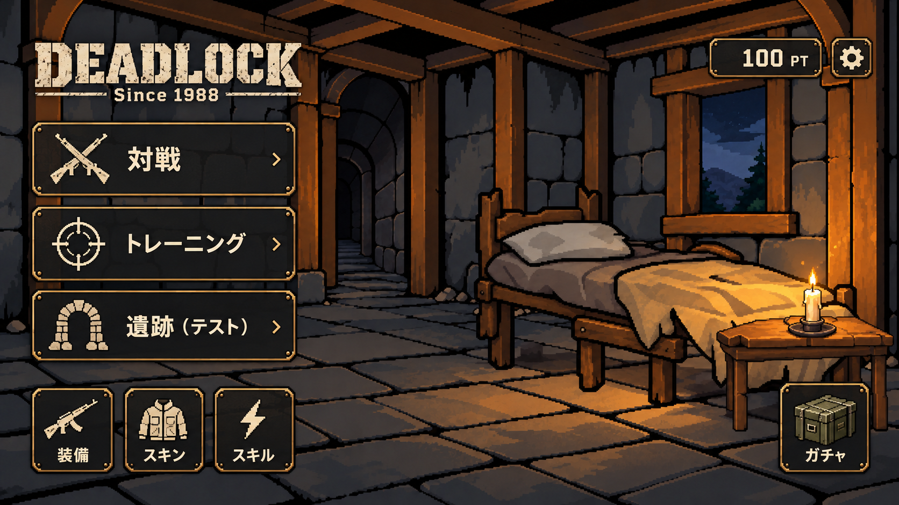

# ホーム画面・画像素材制作仕様
更新日：2026-10-25（日本時間、ホーム背景・蝋燭の正式採用を反映。D-045）
対象：DEADLOCK: Since 1988／ホーム画面
状態：ユーザー承認済みの完成イメージと制作方針。数値は下記で「制作目安」「暫定」を区別する。

## 1. 画像制作AIへ
本書を最初に読み、下の完成イメージを確認する。指定された素材だけを制作する。
**部品は対象物だけを切り抜いた透過PNGで納品する。全素材を1672×941にそろえる必要はない。**
既存素材を整理する場合は、形・配色・陰影・質感を保持し、再生成しない。必要な操作は切り抜き・透過整理・配置情報の記録。
参照画像を読み取れない場合は、その旨を報告し、見たと仮定して制作しない。

## 2. 承認された完成イメージ

2026-10-23、ユーザーが「OK,良いです！」として承認したホーム画面の視覚的な方向性。
石造りの室内、木製の梁、中央寄りの暗い出入り口、右側の夜景の窓、ベッド、小さなテーブル、蝋燭。左側に主要メニュー、左下に装備等、右上にポイントと設定、右下にガチャを置く。
暖色の蝋燭光と寒色の夜景を対比させる。太めの暗い輪郭、段階的な陰影、粗さのあるピクセルアートを維持する。写実化・滑らかな3D化・過剰な細密化はしない。

この画像は**完成像の参考**であり、分割済みの実装素材でも実機スクリーンショットでもない。既存の採用済み部品の形状は元素材を優先する。画像にある「100 PT」は表示例で、初期所持ポイントを決定しない。
ゲームルールは [GAME_SPEC.md](GAME_SPEC.md) と [DECISIONS.md](DECISIONS.md) に従う。D-006の脱出方式不採用を維持する。「遺跡（テスト）」は開発用入口で、正式モードの追加を意味しない。既存採用ロゴ・戦闘用操作アイコンを本画像で自動的に置き換えない。

## 3. 分類と分割
| 分類 | 内容 | 除外 |
| --- | --- | --- |
| ベース | 壁・床・天井・柱・梁・窓枠・出入り口の枠 | 開口部の向こうの景色、家具、可変の光、UI |
| 背景 | 窓外の夜景、出入り口の奥の廊下、天気 | 手前の枠と室内構造 |
| 家具 | ベッド、テーブルを各1素材 | 他の家具、独立した接地影 |
| 小物 | 蝋燭本体＋芯＋燭台 | 炎、発光、周囲への照り返し |
| 接地影 | 家具・小物の接地部分の半透明の影 | 家具本体 |
| 照明 | 炎、発光、表面への照り返し | 元の背景や家具の全面コピー |
| UI | ロゴ、アイコン、プレート、装飾枠 | 背景や家具、可変文字・数値 |
| 確認用 | 実素材の合成プレビュー | ゲーム用素材への混入 |

ベースは1672×941の基準画像とし、窓・出入り口の開口部を透明にする。
窓外と出入り口の奥は別素材。開口部より少し広く描き、枠の裏へ重ねる。必要なら開口部マスクで表示を制限する。
既存ベースの明暗は維持し、蝋燭の可変照明だけを追加レイヤーに分ける。天候の追加は差し替え可能な構造を用意する方針であり、初回に全天候を作る要求ではない。

## 4. 座標・固定配置枠
基準画面は1672×941、左上原点、Xは右向き・Yは下向き。画像寸法と画面での表示寸法を区別する。
以下は承認画像を基にした**初回制作・組み込み用の目安**。画像の全透明領域を含む寸法ではなく、表示された物体の外形。最終値は実合成で確定して配置定義に記録する。

| ID | 役割・外形 | 表示枠目安（x,y,幅,高さ） | 配置基準 |
| --- | --- | --- | --- |
| bed | 木製一人用寝床、枕・垂れる毛布、右手前へ伸びる奥行き | 880,340,730,415 | 床上の足元。右側の壁際を固定枠とする |
| table | 低い木製サイドテーブル、上面と正面の脚が見える | 1330,585,330,220 | 右手前の床。寝床の足元へ一部重なる |
| candle_body | アイボリーの使いかけ蝋燭1本、暗い金属受け皿 | 1460,545,100,90 | テーブル天板上の受け皿接地点。約1510,630 |
| window | 枠の奥の夜景 | 開口部に合わせて背景素材を配置 | 開口部マスクを基準 |
| doorway | 暗い廊下 | 開口部に合わせて背景素材を配置 | 出入り口マスクを基準 |

家具はこの配置場所・大まかな形・表示サイズを共通の制作枠として固定し、差し替えごとに位置を決め直さない。家具の縦横比を保ち、非等方の引き伸ばしをしない。
蝋燭はテーブルの子として配置し、炎の根元は芯の先端へ合わせる。影も対応する家具・小物にひも付ける。
切り抜き時は元のcrop矩形（x,y,w,h）と基準点を残し、見た目の配置が変わらないよう補正する。

配置定義は Assets/Game/Art/Home/home_layout.json（2026-10-25作成。ホームシーンの生成 `Deadlock.Editor.HomeSceneBuilder` が読む。実行時に読み込むローダーはない）。
各素材にid、path、sourceSize、cropRect、pivot、position、displaySize、parent、sortingOrderを持たせる。pivotは切り抜き画像の左上を(0,0)、右下を(1,1)とする。UnityへのY軸変換は取り込み側で行う。値の正本は実装時にこの定義へ集約する。

## 5. ホームUI・アイコン
黒～チャコールの半透明プレート、落ち着いた真鍮色の縁、くすんだアイボリーのアイコンと文字。角を少し丸め、傷みは控えめにする。背景の雰囲気と文字の読みやすさを両立する。

| 配置 | ラベル | アイコン |
| --- | --- | --- |
| 左上 | DEADLOCK / Since 1988 | タイトルロゴ。既存の採用ロゴを優先し、必要な変更は別途確認 |
| 左側上段 | 対戦 | 交差した銃 |
| 左側中段 | トレーニング | 的・照準 |
| 左側下段 | 遺跡（テスト） | 石のアーチ |
| 左下 | 装備 | ライフル |
| 左下 | スキン | ジャケット |
| 左下 | スキル | 稲妻 |
| 右上 | ポイント表示 | 数値＋PT（文字はUnity側） |
| 右上 | 設定 | 歯車 |
| 右下 | ガチャ | 軍用の物資箱 |

アイコンは1種類1PNG、文字とプレートを含めず、透明な周囲を切り抜く。統一の線幅・ドット粒度・光の方向を使う。初回の図柄制作枠は128×128程度、物資箱は160×128程度を目安とするが、全画面キャンバスは使わない。
プレートと枠はアイコンから分離し、長方形ボタン用・正方形ボタン用・ポイント表示用を共通部品化する。拡縮時に装飾が伸びないよう9-slice等を実装側で設定する。
ラベル・ポイント・使用不可等はUnityで描画する。通常・押下・選択・使用不可はUIの色や透明度で表現し、同じ図柄の大量の派生PNGを作らない。

16:9での配置目安：左メニューx=60〜550、y=225〜670。下部アイコンy=720〜880。右上ポイント・設定x=1320〜1620、y=70〜150。これは端末の固定ピクセル座標ではない。
UIはSafe Area内に配置する。背景と家具は同一の座標変換で扱い、UIは独立レイアウトとする。
画面への表示方式（2026-10-25採用、D-045）：画面が基準（1672×941、ほぼ16:9）以上に横長ならCover（画面を覆い、上下を均等に切る。iPhone 16 Proでは倍率1.568、上下各86基準px）、それより縦長ならFit（全体を表示し、余白は黒。iPad等の暫定）。端末名ではなく縦横比で選び、画面サイズが変わると再計算する。背景はSafe Areaで縮めず、メニューUIの親だけをSafe Areaに合わせる。ホームのメニューUIは次工程で、現在は未実装。横長・4:3でも縦横比を伸ばさず、必要に応じ余白や配置を調整する。家具や蝋燭が切れたり、文字・操作領域が重なったりしないよう実装時に確認する。
戦闘中の照準・ジョイスティック・攻撃ボタンはホームには表示しない。

## 6. 蝋燭・照明差分
本体＋燭台／炎／発光／照り返しを分離する。
明るさは背景透過の差分画像を一定間隔で切り替えて変化させる。元の家具・部屋は変更しない。

初回制作の暫定値（2026-10-25に下の「採用値」で確定。D-045）：
- 4フレーム（00〜03）、順番00→01→02→03→00。
- 0.15秒間隔、合計0.6秒。実機の見え方で調整可能。
- 弱→中→強→中間程度の小さな変化。強い点滅にしない。
- 炎・発光・照り返しは同じフレーム番号で同期。
- 消灯時は3種類の光レイヤーを非表示。本体と燭台は残す。

炎：小さな暖色の炎、根元固定、上部だけがわずかに変化。周囲のにじみは発光へ分離。
発光：芯付近の控えめな半透明の暖色光。
照り返し：天板・蝋燭・近くの毛布や床など、光が当たる表面だけ。通常のアルファ合成で成立するRGBAを基本とし、数値的な画像の引き算ではない。暗くする差分が必要な場合は別のshadowレイヤーとし、additive等の混合方式を暗黙に変えない。
照り返しが手前の物体を透過して見えないよう、対象別のマスクまたは対象別レイヤーを使う。

採用値（2026-10-25、ユーザーが iPhone 16 Pro の実機検証のあと正式採用。D-045）：
- 共通のフレーム番号で0.15秒ごとに切り替える（値は `Assets/Game/Data/HomeLighting.asset` で調整可能）。
- 炎：00→01→02→03。照り返し：00→01→02→03。
- 発光：01→01→02→03。フレーム00でも発光01を表示する（発光00は縁のある平らな円盤に見えるため使わない）。
- 照り返し：4フレーム共通の描画アルファ0.65（PNGの画素は変えない。リニア色空間での見え方を完成イメージに近づけるため）。
- 照り返し02は納品原本、00・01・03は02のアルファを0.85・0.95・0.90倍した派生素材（RGB・キャンバス・配置は同じ）。
- 既知のWARN：床の光だまりの左端が縦に直線状に見える。照り返し素材の形による。素材は加工しておらず、直す場合は素材の修正が必要。

**連番は系列ごとに全フレーム共通の切り抜き範囲・ピボットを使う。**
フレームごとに違う余白へ切り抜かない。光の広がりを収める必要な透明余白は残す。1672×941に統一する必要はない。

## 7. 透過・画質・納品
PNG／RGBA／sRGB。背景透過は実アルファで、黒や市松模様の塗りつぶしを使わない。
ベース・家具・小物本体・アイコンは原則アルファ0/255。接地影・光・天候・UIプレートは半透明可。
2値化が必要なら元画像を保存して派生画像で実施する。しきい値128を初期候補とし、輪郭や芯が欠ける場合はマスクを調整する。数値を満たすだけで良品と判定しない。
リサイズは縦横比を維持し最近傍を基本とする。ピクセルアート本体はPoint、ミップマップなしを基本とし、光レイヤーのフィルタは別管理する。
納品物：
1. 指定した部品のみの透過PNG。
2. 元画像、切り抜き範囲、ピボット、表示寸法、配置座標を記載したメタデータ。
3. 使用した背景・部品の版を明記した実合成プレビュー。
4. 連番は枚数・再生順・間隔を記載。
5. 不要な色残り・輪郭欠けを明暗両背景で確認した結果。

合成は納品PNGと記録した配置を使って行う。部品画像とプレビューでピクセル寸法が異なること自体は不具合ではない。記録された倍率と位置で再現できればよい。
確認画像を別途生成して、実合成の代わりにしない。

## 8. 描画順
背景 → 開口部内の天候 → ベース → 家具の接地影 → 家具 → 小物の影 → 小物本体 → 表面への照り返し → 炎・発光 → UI。
照明は必要に応じ対象別に分け、前後関係を守る。

## 9. 保存先と命名
| 保存先 | 内容・代表名 |
| --- | --- |
| Assets/Game/Art/Home/Base/ | room_base.png |
| Assets/Game/Art/Home/Backgrounds/ | window_night.png、doorway_corridor.png |
| Assets/Game/Art/Home/Weather/ | 天候が必要になった際に作成 |
| Assets/Game/Art/Home/Furniture/Bed/ | bed.png、bed_shadow.png |
| Assets/Game/Art/Home/Furniture/Table/ | table.png、table_shadow.png |
| Assets/Game/Art/Home/Props/Candle/ | candle_body.png |
| Assets/Game/Art/Home/Lighting/Candle/ | candle_flame_00.png、candle_glow_00.png、candle_light_00.png（各00〜03） |
| Assets/Game/Art/Home/UI/Icons/ | icon_battle.png、icon_training.png、icon_ruins.png、icon_equipment.png、icon_skin.png、icon_skill.png、icon_settings.png、icon_gacha.png |
| Assets/Game/Art/Home/UI/Frames/ | button_wide.png、button_square.png、points_plate.png |
| docs/review/home-background/ | home_concept_approved.png、実合成プレビュー、採用素材一覧 |
| art-source/home/originals/ | 原本。UnityのAssets外 |
| art-source/home/archive/ | 旧版・不採用版。UnityのAssets外 |

これは整理後の目標構成。既存ファイルの移動・削除をこの文書作成で実施したことは意味しない。
採用フォルダは1用途1正本とし、(1)、(2)、final、最新、修正版をファイル名へ付けない。履歴はGitで管理する。連番は2桁で統一する。
元ファイル名と採用先、SHA-256、元寸法、crop矩形、採用状態をASSET_MANIFEST.mdに記録する。ファイル名だけで最新版を判断しない。

## 10. 既存画像の整理
対象はホーム用の部屋・背景・家具・小物・影・照明。武器・戦闘HUD等の既存採用素材を一括変更しない。
1. 一覧とハッシュを採り、完全重複・旧版・採用候補を分類。
2. 採用原本を特定し、原本を保全。
3. 部品のみの切り抜き版を作成。RGB・形・質感を保持。
4. 旧画像内の座標から新しい配置情報を計算し、影も同時に合わせる。
5. 実合成で構図と接地感を確認。
6. 採用一覧を作り、旧版をアーカイブへ分離。
7. Unity参照がある素材の移動では.meta／GUIDと参照を保持。
8. 重複の削除は参照確認とユーザー承認後。整理途中で原本を消さない。

## 11. 制作順
ベースと背景の採用・分離 → ベッドとテーブルの切り抜き・配置枠確定 → 蝋燭本体 → 炎と照明差分 → ホーム用アイコンとプレート → 実合成と端末比率確認。
毎回依頼する素材IDを限定する。依頼されていない部品を追加・再生成しない。

## 12. 制作依頼の共通文
> この仕様書と承認済み完成イメージを読み、今回指定した素材IDのみ制作してください。
> 部品は対象物だけの透過PNGとし、全画面サイズの余白は不要です。
> 既存採用素材の整理では再生成せず、形・配色・質感を維持してください。
> 連番は系列内で共通のキャンバスと基準点を使ってください。
> UI文字やポイント数値を画像に焼き込まないでください。
> 納品PNG・配置情報・同じ素材による実合成プレビューを提出してください。
> 本仕様にない機能・家具・装飾の追加は行わないでください。

